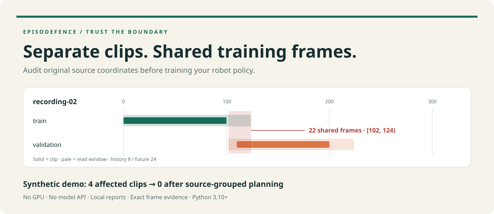

<div align="center">

# EpisodeFence

### Your clips are separate. Are the frames your model reads?

**Find temporal leakage in robot learning splits — with exact frame evidence.**

[English](README.md) · [简体中文](README.zh-CN.md) · [Manifest format](docs/manifest.md) · [How it works](docs/algorithm.md)


</div>

EpisodeFence checks whether train, validation, and test clips read overlapping frames from the **same physical recording**. It accounts for observation history, action horizons, alternate camera views with shared provenance, and optional recording-session isolation. Then it can generate a new split manifest and check its own result.

**Local Python CLI. No GPU. No model calls. No dataset uploads.**



## Why clip boundaries are not enough

Suppose a training clip ends at frame 100 and a validation clip starts at frame 110. The raw clips do not overlap. Add 8 frames of observation history and 24 future action frames:

```text
                    100   110
train clip       [---)       read window [0, 124)
validation clip            [---)        read window [102, 224)

22 source frames are shared: [102, 124)
```

This applies when your loader reads context from the original recording beyond a clip boundary. If the loader clamps at each clip, encode the actual read region instead. LeRobot already clamps at episode boundaries; this tool does **not** claim that standard episode-level LeRobot splits have this bug.

## Try the full workflow in 30 seconds

Requires Python 3.10+. From this source checkout, no installation is needed:

```sh
python -m episode_fence demo -o demo-output
```

Open `demo-output/before.html` and `demo-output/after.html` in a browser. The synthetic demo includes a cross-camera source overlap and a hidden action-window overlap: **4 affected clips before planning, 0 afterward**, under the same declared policy. No videos or models are downloaded. Generated [before](docs/demo/before.html) and [after](docs/demo/after.html) reports are also included; download them to view locally.

For a reusable command:

```sh
python -m pip install .
episode-fence --help
```

This project has not been published to PyPI. Install from this checkout or the supplied wheel; do not assume a similarly named package belongs to this project.

## Three useful commands

```sh
# Check a manifest. Exit 1 means conflicts, even when a report was written.
episode-fence audit examples/clips.jsonl --history 8 --future 24

# Share a standalone HTML report. No server or external assets required.
episode-fence audit examples/clips.jsonl --history 8 --future 24 --format html -o review.html

# Keep each physical source together, balance approximately, then re-audit.
episode-fence plan examples/clips.jsonl --history 8 --future 24 --ratios train=0.8,validation=0.2 -o planned.jsonl --report plan.json
```

`plan` creates a **new evaluation split**, not a patch to an already valid benchmark. It changes assignments without rewriting the dataset. Review the plan, wire it into your loader, and retrain before using the new holdout for evaluation. Existing files are protected unless `--force` is explicit; input manifests cannot be overwritten.

## What you get

| Capability | Practical use |
|---|---|
| Exact source-frame witnesses | Know which two clips share which frames; no similarity-score threshold to tune. |
| History, future, and embargo | Check the full read window, including temporal separation requirements. |
| Optional group isolation | Keep a recording session, operator, or scene in one split, using your chosen group IDs. |
| Connected-component planning | Keep transitive overlaps together; fail when the constraints make separate splits impossible. |
| LeRobot v2.x / v3.0 metadata import | Read local episode metadata without PyTorch, videos, or dataset downloads. |
| JSONL, CSV, Python API | Connect custom robotics, imitation-learning, and temporal-data pipelines. |
| JSON, Markdown, HTML, terminal reports | Use the same check locally and in CI. |

## Bring your own manifest

One JSON object per clip; all coordinates are integer frames in the **original source**. Stop frames are excluded:

```json
{"id":"front/train-01","source":"physical-take-01","start":0,"stop":100,"source_frames":300,"split":"train","task":"pick cup","group":"session-a"}
{"id":"wrist/val-01","source":"physical-take-01","start":40,"stop":140,"source_frames":300,"split":"validation","task":"pick cup","group":"session-a"}
```

Different cameras, crops, and augmented copies from the same take must share a source ID and aligned coordinates. `task` and `group` are optional. Source identity cannot be inferred from arbitrary filenames or pixels. See [the manifest contract](docs/manifest.md), including padding and resampling.

## Import LeRobot metadata

```sh
# v2.x requires only Python. v3.0 additionally needs PyArrow:
python -m pip install ".[lerobot]"

episode-fence import-lerobot /data/my-dataset --dataset-id lab/my-dataset --split-map splits.json -o episodes.jsonl
episode-fence audit episodes.jsonl
```

`splits.json` is a complete mapping such as `{"0":"train","1":"validation"}`. Without it, episodes are labeled `unassigned`; a one-split audit explicitly warns that no holdout was checked. Imported source IDs default to `dataset-id::episode-index`. For converted or sliced datasets, supply a complete `--provenance` mapping to link back to original recordings. **Two exports with different dataset IDs are not automatically matched.** See [the integration guide](docs/lerobot.md).

## Python API

```python
from episode_fence import Policy, audit, plan
from episode_fence.io import read_manifest

clips = read_manifest("examples/clips.jsonl")
policy = Policy(history=8, future=24, embargo=0)
report = audit(clips, policy)
assert report["summary"]["affected_clips"] == 4
new_clips, diagnostics = plan(clips, policy=policy)
assert diagnostics["verification"]["status"] == "clear"
```

## Scope and tradeoffs

- **A clean report is a bounded claim.** It checks declared provenance and frame/group boundaries. It does not detect unknown duplicate recordings, visual similarity, normalization leakage, pretrained-model contamination, or statistical dependence between different takes. It does not measure policy success.
- **Read windows are contiguous envelopes.** Sparse or irregular offsets can produce conservative findings. Every record in a run uses the same history/future policy. Resample to a common frame coordinate system first.
- **Planning is approximate.** The deterministic greedy planner balances summed clip lengths, not unique frames. It reports actual ratios and missing task coverage; it does not stratify, preserve chronology, optimize ratios globally, or preserve an existing holdout. Default `--unit source` keeps entire recordings together. Advanced `--unit overlap` permits separated parts of a recording in different splits.
- **Scale is explicit.** Up to 100,000 clips and 16 split labels. The audit detects all affected clips, but stores at most 200 representative witnesses by default, not every conflicting pair. HTML renders at most 30 sources and 80 clips per source. See [algorithm and complexity](docs/algorithm.md).
- **Local reports contain your labels.** Source IDs, task labels, groups, and clip IDs are not redacted. Review reports before sharing.

## Related work

[Calibra](https://github.com/Calibra-Robotics/Calibra) audits robotics data quality and includes duplicate/near-duplicate leakage checks. [LeRobot dataset tools](https://huggingface.co/docs/lerobot/using_dataset_tools) split, merge, and transform datasets. [scikit-learn TimeSeriesSplit](https://scikit-learn.org/stable/modules/generated/sklearn.model_selection.TimeSeriesSplit.html) provides chronological cross-validation with a sample gap.

EpisodeFence focuses on **declared physical provenance + expanded frame windows + portable evidence + a verified split manifest**. It complements these tools; it does not claim to be the first leakage checker. All implementation and demo data here are original.

## Development

```sh
python -m unittest discover -s tests -v
```

The core test suite needs no third-party packages. Optional Parquet tests run when PyArrow is installed. CI is configured to check installed wheels on Linux and Windows. See [VALIDATION.md](VALIDATION.md) for checks actually run and their limitations, and [CONTRIBUTING.md](CONTRIBUTING.md) for contribution ideas.

**v0.1.0 alpha.** This is a working first release, not evidence of adoption or improved robot performance. Useful feedback: a sanitized manifest from a real pipeline, your loader's read-window semantics, and whether the report caught a split mistake you would otherwise have missed.

MIT licensed. Not affiliated with Hugging Face or LeRobot.
