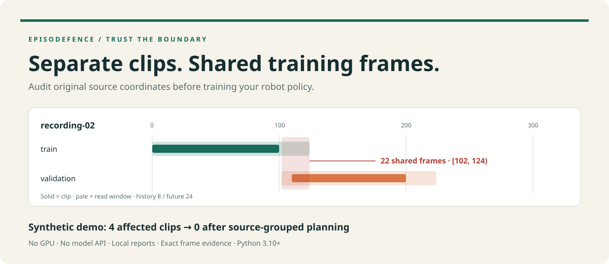

# EpisodeFence

**训练片段分开了，模型实际读取的帧也分开了吗？**

[English](README.md) · [数据格式](docs/manifest.md) · [算法说明](docs/algorithm.md)

EpisodeFence 是机器人学习数据的划分检查工具。根据原始录制来源和帧坐标，检查训练集、验证集、测试集之间是否发生片段重叠，并把历史观测、未来动作窗口及可选的采集会话隔离纳入检查。

**无需 GPU、模型 API 或上传数据。核心功能只依赖 Python 标准库。**



## 一条命令体验

Python 3.10 以上，在项目目录运行：

```sh
python -m episode_fence demo -o demo-output
```

打开 `demo-output/before.html` 和 `after.html`。合成示例展示两类问题：同一录制的不同相机视角被放进不同数据集；原始片段没有交集，但历史和动作窗口发生重叠。重新划分后，在相同规则下，受影响片段从 **4 个降至 0 个**。

这不是实际机器人训练结果，也不代表策略性能提升。

## 使用方式

```sh
# 直接从源码运行，无需安装
python -m episode_fence audit examples/clips.jsonl --history 8 --future 24

# 输出独立 HTML 时间轴报告；发现冲突时退出码仍为 1
python -m episode_fence audit examples/clips.jsonl --history 8 --future 24 --format html -o review.html

# 生成新划分，默认保持每个原始录制完整
python -m episode_fence plan examples/clips.jsonl --history 8 --future 24 -o planned.jsonl --report plan.json
```

`history=8` 表示片段之前额外读取 8 帧；`future=24` 表示之后额外读取 24 帧。若动作长度为 H、包含当前帧，则未来偏移为 H−1。所有区间使用左闭右开形式 `[start, stop)`，并裁剪到原始录制的边界。应填写你的加载器真正读取的范围。

特别注意：标准 LeRobot 加载器会在 episode 边界做裁剪，本工具不声称标准 episode 划分一定有窗口泄漏。这个检查更适合自定义切片、跨相机复制、增强数据、多来源合并等流程。

## 输入数据

每行一个 JSON 对象，也支持同名列的 CSV：

```json
{"id":"front/train-01","source":"take-01","start":0,"stop":100,"source_frames":300,"split":"train","task":"pick cup","group":"session-a"}
```

- `id`：这个片段的唯一标识。
- `source`：原始物理录制的全局唯一标识，同一次录制的视角或增强副本使用相同值。
- `start`、`stop`、`source_frames`：原始录制坐标中的起止帧和总帧数。
- `split`：训练、验证、测试等划分名称。
- `task`、`group`：可选任务和分组标签。启用 `--isolate-groups` 时，每条记录都必须有 group。

工具不会从文件名或画面自动推断原始来源。不正确的来源标签会导致漏检。

## LeRobot 接入

支持本地 v2.x 的 `meta/episodes.jsonl` 和 v3.0 的分片 Parquet episode 元数据。读取 v3.0 需安装可选依赖：

```sh
python -m pip install ".[lerobot]"
python -m episode_fence import-lerobot /data/dataset --dataset-id lab/dataset --split-map splits.json -o episodes.jsonl
```

`splits.json` 是完整的 episode 索引到 split 的映射，例如 `{"0":"train","1":"validation"}`。不提供时全部标为 `unassigned`，报告会提醒没有验证独立留出集。

转存、切片或合并过的数据需要额外的 `--provenance` 映射，以恢复原始录制来源和偏移。详见 [LeRobot 接入文档](docs/lerobot.md)。本项目尚未发布到 PyPI，请从本目录安装或使用交付的 wheel。

## 能做和不能做

可以提供精确帧区间证据、离线可交互报告、JSON/Markdown 输出和 CI 退出码；可以按连通分量重新划分，并再次检查结果。

它不能发现未知来源的相似演示，不能证明跨录制统计独立，不能检查归一化统计泄漏，也不能代替真实机器人测试。划分比例按片段帧数近似平衡，不保证任务分层或时间先后顺序。报告会列出实际比例和缺失的任务覆盖。

`plan` 会创建新的评估划分，不保留旧留出集。你需要审核并接入训练加载器，重新训练后才能用新验证集评价；它不直接改写原始数据。

## 开发与测试

当前为 **0.1.0 alpha**，MIT 开源。运行测试：

```sh
python -m unittest discover -s tests -v
```
